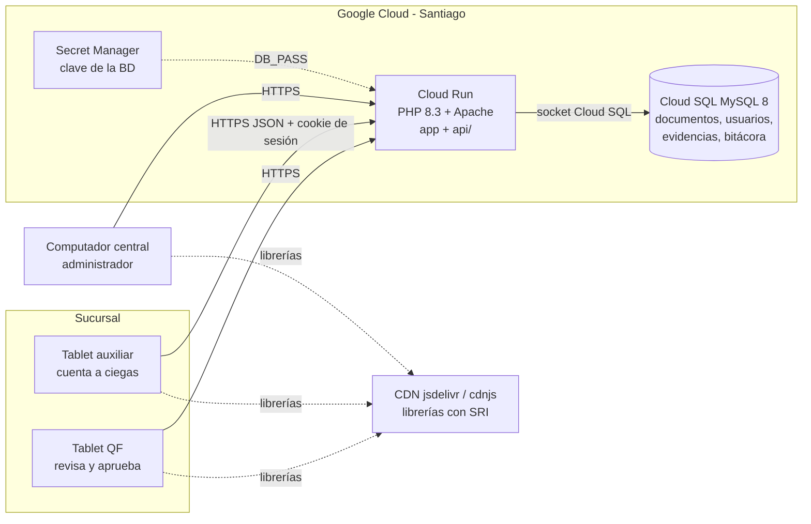

# Arquitectura

## Cómo viajan los datos

1. **El administrador** sube el maestro (Excel), los costos y el pedido o el reporte de existencias (PDF, Word, Excel o foto). La lectura se hace **en el navegador**, y al servidor solo llega el documento ya armado (`POST api/documentos.php`).
2. **El auxiliar** abre el documento. El servidor le entrega los productos **sin cantidades ni costos**. Cada cantidad se guarda con `PUT` (con número de versión) y cada acción va a la bitácora (`POST api/bitacora.php`, en tandas).
3. **El QF** recibe el documento completo, revisa las desviaciones y aprueba. El servidor verifica que no queden pendientes.
4. **Las fotos de evidencia** se suben a `api/evidencia.php` y quedan en la tabla `evidencias`. Solo las ve quien puede ver el documento.

## Sin servidor (GitHub Pages / demo)

Los mismos archivos estáticos funcionan solos: los datos quedan en el navegador y los documentos se envían a la sucursal por enlace comprimido o archivo `.pedido`. El service worker permite trabajar sin internet.

## Tareas programadas, colas y webhooks

No hay tareas programadas ni webhooks. Lo único periódico es:
- **Limpieza de sesiones vencidas:** la hace PHP solo (`gc` de `DbSession`).
- **Cola de bitácora en la tablet:** si se corta internet, los eventos esperan en `localStorage` (`revision-bitacora-cola`) y se envían al volver la conexión. El servidor acepta la hora del equipo solo si tiene menos de 3 días de antigüedad.
- **Respaldos de Cloud SQL:** diarios a las 03:00 (configurados en `DEPLOY.md`).

## Integraciones externas

Ninguna por ahora (no hay conexión con el ERP ni con SAP). Los datos entran por archivo.
