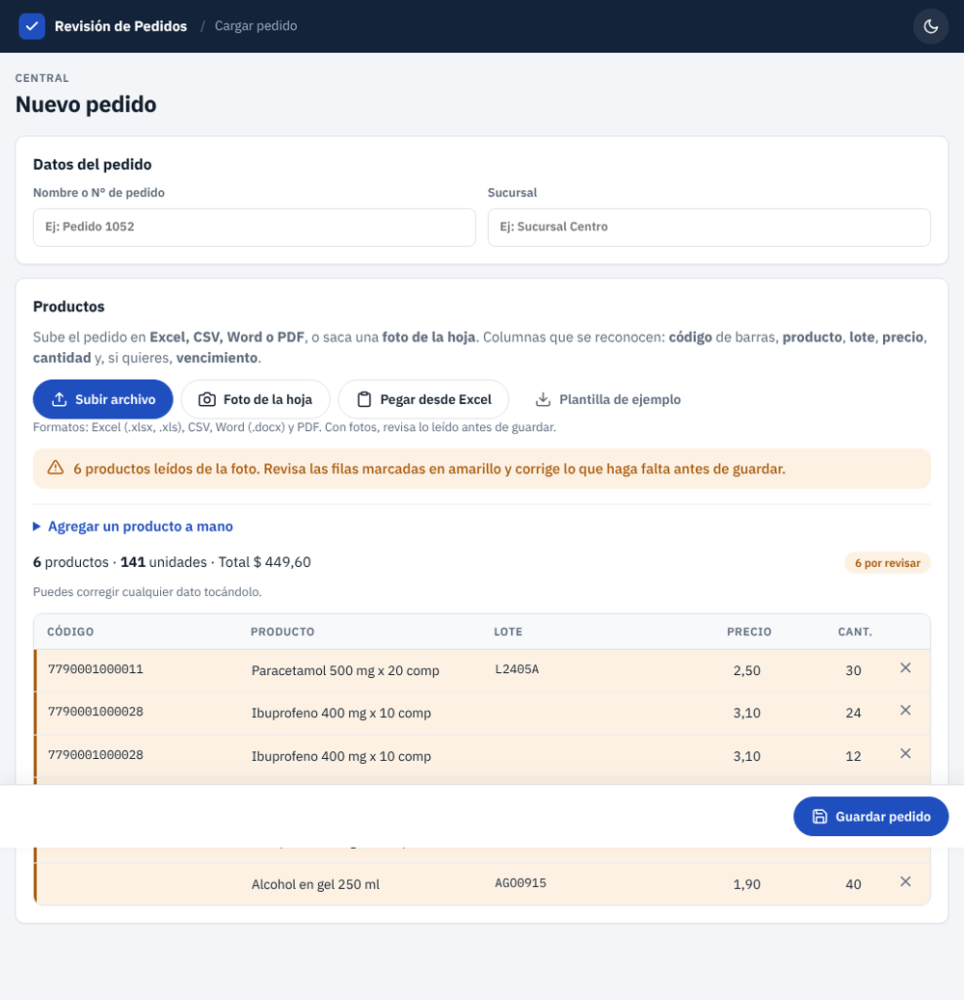
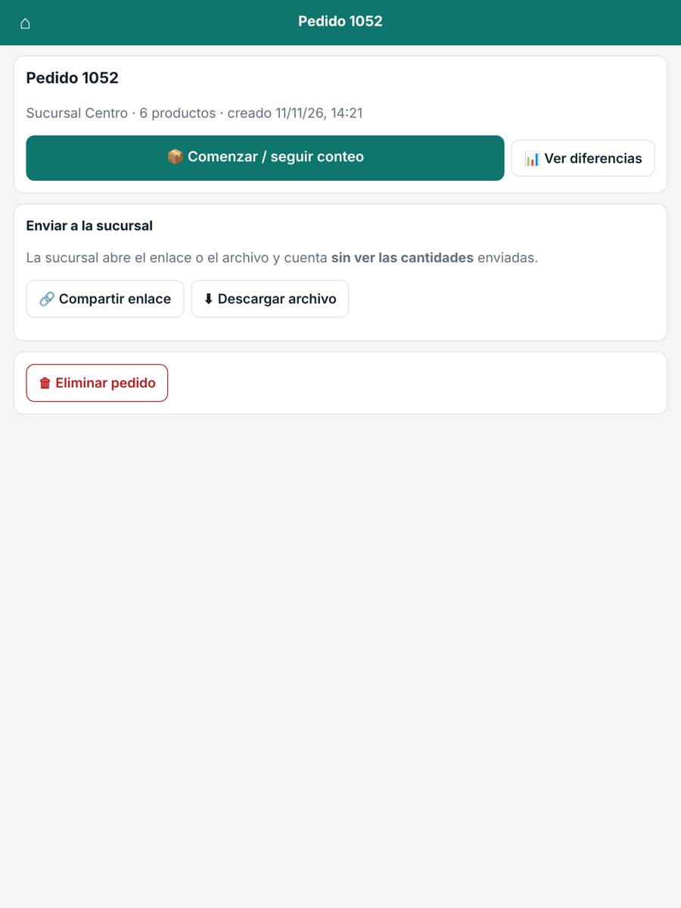
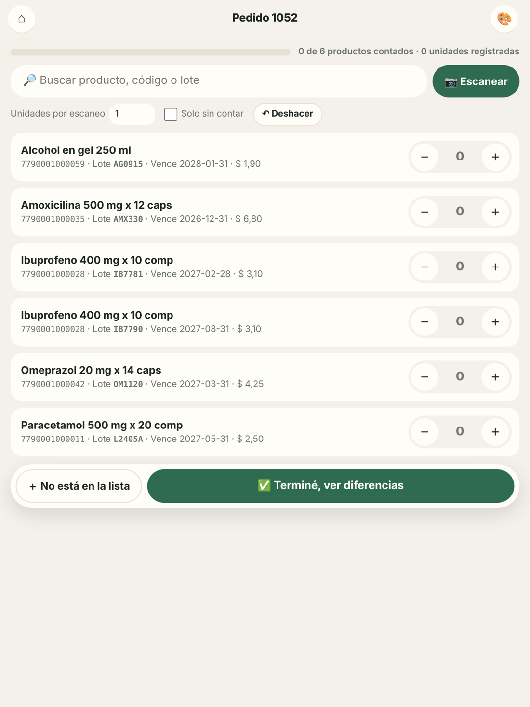
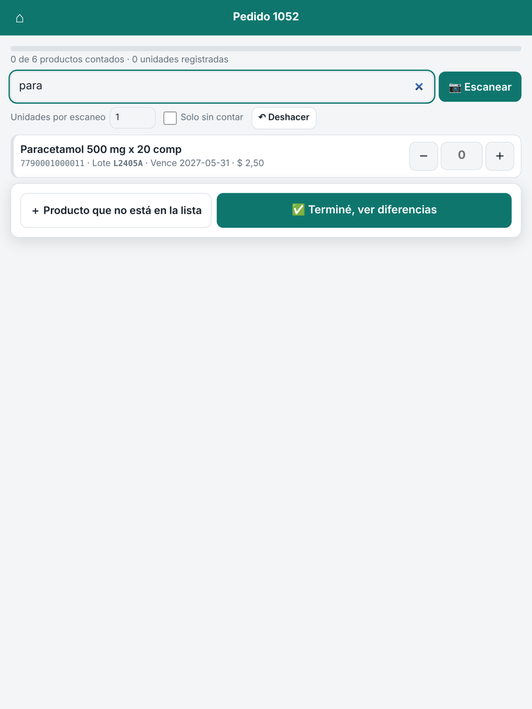
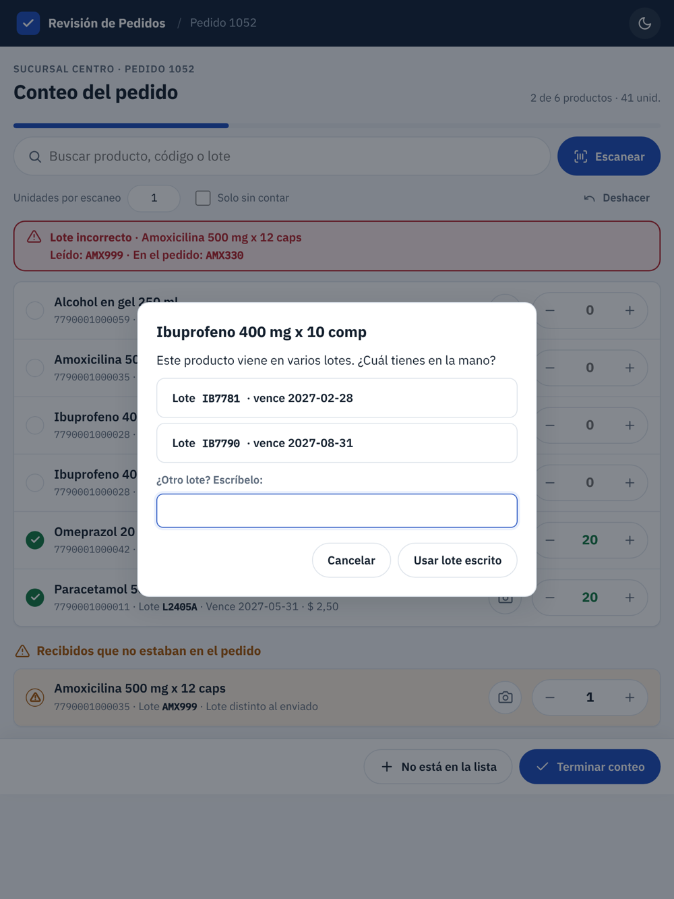
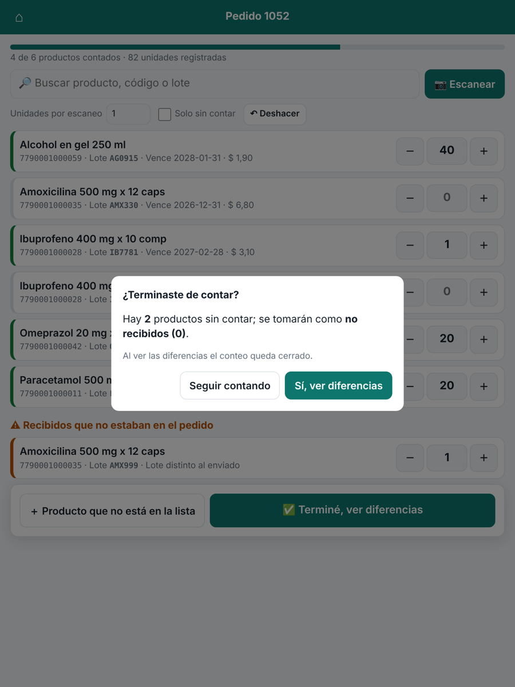
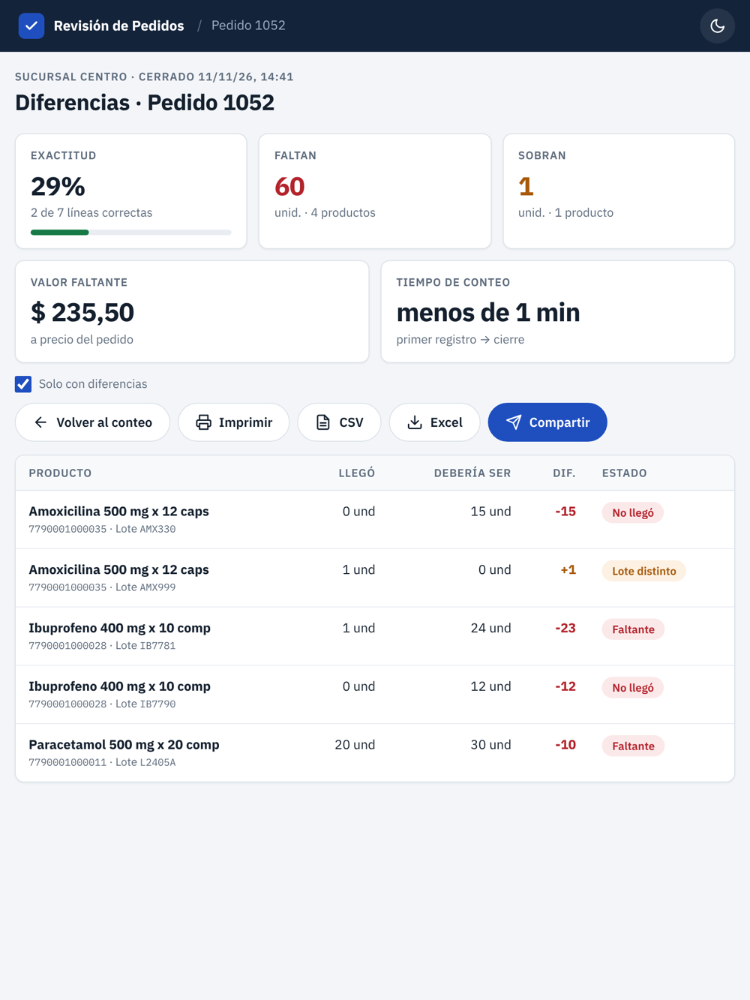
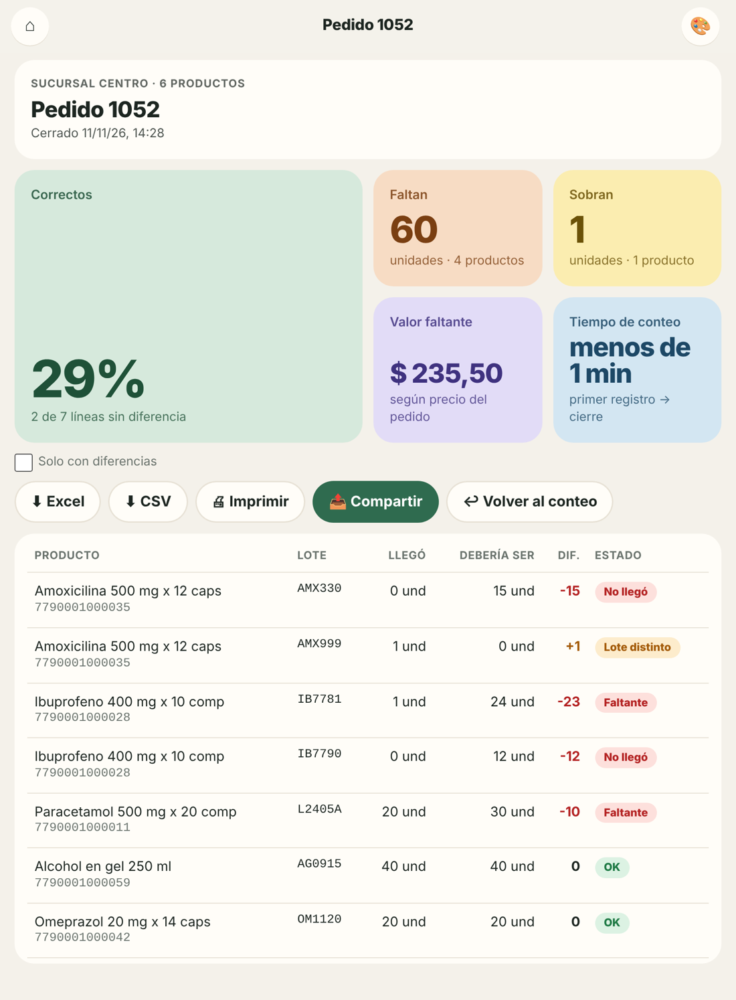

# Revisión de pedidos en sucursal

App web para revisar el pedido que llega a la sucursal sin buscar producto por producto en una hoja impresa.

## Cómo funciona

1. **Central – cargar el pedido.** Sube el pedido en **Excel, CSV, Word (.docx) o PDF**, pega las filas desde Excel o saca una **foto de la hoja**. Columnas: código de barras, producto, lote, precio, cantidad y, opcional, vencimiento. Hay ejemplos en `ejemplo-pedido.csv`, `ejemplo-pedido.docx` y `ejemplo-pedido.pdf`.
   - Word y PDF: se lee la tabla del documento. Si el Word no tiene tabla, se lee línea por línea y se marca para revisar.
   - Foto: la app endereza la imagen, borra las líneas de la tabla y lee el texto. Todo lo leído queda **en amarillo para revisar** y cada dato se puede corregir antes de guardar.
   - La sucursal abre lo recibido con **Abrir pedido recibido** (archivo .pedido) o con el enlace.
2. **Enviar a la sucursal.** Botón *Compartir enlace* (WhatsApp, correo) o *Descargar archivo*. El pedido viaja comprimido: la sucursal **no ve las cantidades enviadas**.
3. **Sucursal – contar.** Abre el enlace y cuenta lo que trae la cubeta:
   - Buscador por nombre, código o lote.
   - **📷 Escanear** con la cámara del celular: cada lectura suma 1 (o las unidades que indiques por escaneo, útil para cajas).
   - Si el código es **DataMatrix / GS1-128** (los que traen lote y vencimiento), la app **lee el lote y verifica** que sea el del pedido. Si no coincide, avisa con sonido y lo registra como “Lote distinto”.
   - Si el producto viene en varios lotes y el código no trae lote, pregunta cuál es.
   - Productos que llegaron pero no estaban en el pedido se registran como sobrantes.
   - También sirve un lector de código de barras USB/Bluetooth: se escanea en el buscador.
   - El avance se guarda en el celular; se puede cerrar y seguir después.
   - **Evidencia:** el botón de cámara de cada producto permite indicar un motivo (dañado, vencido, lote distinto…), escribir una nota y sacar o subir fotos.
4. **Terminé, ver diferencias.** Recién ahí se muestra lo contado vs. lo que debería ser:

   | Producto | Lote | Llegó | Debería ser | Dif. |
   |---|---|---|---|---|
   | Paracetamol 500 mg | L2405A | 20 und | 30 und | −10 |

   Se puede exportar a Excel/CSV, imprimir o compartir el resumen por WhatsApp. Si se reabre el conteo, queda registrado.

## Usuarios e inicio de sesión

- La primera vez la app pide crear el **administrador** (nombre, usuario y contraseña).
- El administrador crea usuarios desde el menú de usuario → **Usuarios**, con tres roles:
  - **Administrador:** configura el sistema (usuarios, maestro y costos), carga los pedidos que se despachan a las sucursales y reabre conteos.
  - **QF:** carga el inventario de su sucursal (reporte de inventario de SPOS en PDF), ve el reporte de desviaciones en orden ABC, hace el recuento y aprueba.
  - A cada QF y auxiliar se le asigna su **sucursal** (ej. `CL0007 RENCA`): solo ve y carga documentos de esa sucursal.
  - **Auxiliar:** solo digita cantidades. No ve cantidades del sistema, ni totales, ni si lo que digita coincide. Al finalizar recibe solo un "Conteo finalizado".
- Las contraseñas nunca se guardan en texto (ver Seguridad).
- **Con servidor**, los usuarios son los mismos en todas las tablets. **Sin servidor**, viven en cada equipo: para copiarlos a otra tablet, menú → **Exportar configuración** y, en la otra, **Importar configuración**.

## Flujo de un inventario

1. **QF:** descarga desde **SPOS** el reporte de inventario de su sucursal en PDF y lo sube en **Nuevo inventario**. La app lee la sucursal, la fecha y cada producto con su cantidad del sistema, y le agrega el código de barras desde el maestro (que carga el administrador). Si el reporte es de otra sucursal, no lo deja crear. Si se equivocó de archivo, puede eliminar el inventario mientras nadie haya empezado a contar.
2. **Auxiliar:** cuenta a ciegas (escaneando o digitando) y finaliza.
3. **QF:** abre el **Reporte de desviaciones**, ordenado por **clase ABC** (A = desviaciones que suman el 80 % del valor, B = siguiente 15 %, C = resto) y **revisa cada desviación**: marca si la cantidad contada es correcta (la diferencia es real) o la corrige, y deja una observación. La app mide cuánto tiempo estuvo revisando cada producto.
   - **Revisión aleatoria:** elige al azar N productos de los más caros, de costo medio o de los más baratos (incluidos los que no tuvieron diferencia) para recontarlos.
   - **Buscador:** encuentra cualquier producto del documento para revisarlo.
   - **Aprobar** solo se habilita cuando todas las desviaciones y la muestra aleatoria están revisadas.

Sin costos cargados, el orden ABC y los grupos aleatorios se calculan por unidades (la app lo avisa).

## Tiempo del conteo

En el reporte, la QF ve cuánto se demoró el conteo y cómo se repartió el tiempo:

- **Inicio, fin y tiempo total**, y cuánto de ese tiempo se estuvo **contando**.
- **Pausas:** si pasan más de 5 minutos sin registrar nada, se considera pausa. Se ve cuántas hubo y cuánto duró cada una.
- **Tramos:** por ejemplo, *Tramo 1 · 09:00–09:10 · 10 min* → *Pausa de 4 min* → *Tramo 2 · 09:14–09:44 · 30 min*, con una línea de tiempo y quién contó cada tramo.

Esto también queda en el Excel (hoja *Tiempo del conteo*) y en la bitácora.

Además, **Tiempos del proceso** muestra todo el recorrido de punta a punta, con la hora de cada hito y cuánto pasó entre ellos:

*PDF cargado 08:50 → (espera 20 min) → inicio del conteo 09:10 → (conteo 10 min) → fin 09:20 → (espera de revisión 30 min) → la QF empieza a revisar 09:50 → (revisión 15 min) → aprobado 10:05 · **Total 1 h 15 min***

Mientras no termina, los pasos que faltan aparecen "en curso" o "pendiente". También va al Excel (hoja *Resumen*).

## Bitácora

Menú de usuario → **Bitácora** (administrador y QF), o el botón **Bitácora** del reporte para ver solo ese documento. Registra quién, qué, cuándo (hora de Santiago) y en qué equipo: inicios de sesión (también los fallidos y bloqueos), documentos abiertos, cada cantidad registrada, finalización, apertura del reporte, cada revisión de producto con su tiempo, revisiones aleatorias, búsquedas, filtros, exportaciones, aprobaciones, reaperturas, evidencias y cambios de usuarios, maestro y costos. Se filtra por usuario, acción, documento, fechas y texto, y se exporta a Excel.

- Los registros no se pueden editar ni borrar desde la app. Cada uno guarda la huella (hash SHA-256) del anterior: **Verificar integridad** detecta si alguien alteró o borró registros.
- No guarda contraseñas ni datos sensibles. Al iniciar sesión se informa a los usuarios que su actividad queda registrada.

## Seguridad

- **Con servidor:** las contraseñas se guardan con `password_hash` (bcrypt). Hay bloqueo de 5 minutos tras 5 intentos fallidos, cierre de sesión tras 30 minutos sin uso, cookie de sesión protegida (HttpOnly, SameSite, Secure) y token CSRF. Los permisos se validan en el servidor: el auxiliar nunca recibe cantidades ni costos, y aprobar exige que todo esté revisado. La bitácora no se puede modificar ni borrar, ni siquiera desde la base de datos (triggers y permisos mínimos).
- **Sin servidor:** las contraseñas se cifran con PBKDF2 en el equipo. Sirve para una tablet compartida, pero alguien con conocimientos técnicos y acceso físico a la tablet podría borrar los datos del navegador.
- En los dos modos hay política de seguridad de contenido (CSP), verificación de integridad (SRI) de las librerías externas y exportaciones a Excel/CSV que neutralizan fórmulas escondidas.

## Vencimiento (lo audita la QF)

Si el código escaneado (DataMatrix GS1) trae fecha de vencimiento y faltan **90 días o menos**, la app la guarda sin avisarle al auxiliar, para no distraer el conteo a ciegas. La **QF** la ve en el reporte ("Vence pronto" o "Vencido") y en el Excel (columna *Vencimiento leído*). Si escanea el administrador o la QF, la app sí avisa en el momento.

## Privacidad (Ley 21.719)

- En el inicio de sesión se avisa que la actividad queda registrada, con un enlace a la **Política de privacidad** (también en el menú de usuario).
- El administrador puede **descargar los datos de un usuario** (Usuarios → Datos) cuando una persona los pida.
- La política es una **plantilla: debe revisarla un abogado** antes del uso real (plazo de conservación, responsable y canal de contacto).

## Maestro de productos

Menú de usuario → **Maestro de productos** → subir el Excel (columnas *Material*, *Texto breve de material*, *Unidad medida base*, *Código EAN/UPC*). Con **Subir costos** se agrega un Excel con *Material* (o código de barras) y *Precio* o *Costo*, usado para el orden ABC. Con el maestro, al escanear el código de barras de una caja la app sabe qué producto es, también en pedidos.

## Inventarios

1. **Nuevo inventario** (QF) → subir el **reporte de inventario de SPOS** (PDF o Excel). La app lee la sucursal, la fecha y cada producto con su código, nombre, categoría y cantidad del sistema, y le agrega el código de barras desde el maestro.
2. La sucursal cuenta **sin ver las cantidades del sistema**: escaneando, buscando por nombre o código de material, con filtro por categoría. Si escanea algo que no figura en el reporte, la app muestra el nombre desde el maestro y lo registra como sobrante.
3. Al cerrar: **Contado vs Sistema** por producto (faltante, sobrante, no encontrado, no figura en sistema), con exportación a Excel (material, código de barras, categoría).

Probado con el reporte de inventario real de CL0007 Renca (1.219 productos, 22.969 unidades, 6 categorías): el 91 % de los productos se puede escanear con el maestro.

## Evidencia con fotos

 

El motivo, la nota y las fotos salen en el reporte de diferencias, en el Excel (columnas Motivo, Nota y Fotos) y al **Compartir** se adjuntan las fotos cuando el equipo lo permite (WhatsApp, correo). Al **Imprimir** el reporte las fotos también aparecen. Las fotos se guardan en el dispositivo y se achican para ocupar poco espacio.

## Carga desde una foto

## Diseño

Estilo **Ejecutivo/Marino**: barra azul marino, azul corporativo, tablas ordenadas, íconos de línea y botones redondos. Siempre tema claro, letra Roboto, desplegables propios con buscador, fechas dd-mm-aaaa (hora de Santiago) y montos en pesos chilenos.

## Instalar en la tablet (funciona sin internet)

Abrir la página en Chrome/Safari → menú → **Agregar a pantalla de inicio**. Queda como app con ícono propio y, después de abrirla una vez con internet, se puede contar sin conexión.

Al cerrar el conteo se registra **quién contó** y la hora de inicio y cierre (aparece en el resumen, en el Excel y en el mensaje de WhatsApp).

## Proceso completo (vista en tablet)

### 1. Central: cargar y enviar el pedido
**Paso 1.** Inicio: lista de pedidos. Botón **Cargar pedido nuevo**.

**Paso 2.** Se sube el Excel/CSV. La central ve producto, lote, precio y cantidad. **Guardar pedido**.

**Paso 3.** Pedido guardado. **Compartir enlace** (WhatsApp/correo) o **Descargar archivo** para la sucursal.

### 2. Sucursal: contar lo que llegó
**Paso 4.** La sucursal abre el enlace y toca **Comenzar conteo**.

**Paso 5.** Lista de productos **sin las cantidades enviadas**; todo empieza en 0.

**Paso 6.** Buscador: al escribir "para" aparece el Paracetamol. Se suma con + / − o escribiendo la cantidad.

**Paso 7.** **Escanear** con la cámara: cada lectura suma 1 (o las *unidades por escaneo*) y avisa qué producto contó.

**Paso 8.** Código DataMatrix/GS1 con lote: la app lee el lote y confirma que es el correcto.

**Paso 9.** Lote distinto al del pedido: alerta roja con sonido; queda registrado como diferencia.

**Paso 10.** Mismo producto en varios lotes y código sin lote: la app pregunta cuál es.

**Paso 11.** Avance: verde = contado, naranja = llegó y no estaba en el pedido.

**Paso 12.** **Terminé, ver diferencias**: avisa cuántos productos quedan en 0 y cierra el conteo.

### 3. Resultado: diferencias
**Paso 13.** Diferencias: **Llegó** vs **Debería ser** (ej. Paracetamol 20 und / 30 und → −10).

**Paso 14.** Desmarcando *Solo con diferencias* se ven también los correctos.

**Paso 15.** Tablet en horizontal. Exportar a Excel/CSV, imprimir o compartir por WhatsApp.

## Publicación

- **Demo sin servidor (GitHub Pages):** en GitHub, **Settings → Pages → Source: GitHub Actions**. Cada merge a `main` se publica solo. Solo se publican los archivos de la app, no el servidor ni la documentación.
- **Uso real con servidor (Google Cloud Run + Cloud SQL):** paso a paso en [`DEPLOY.md`](DEPLOY.md).
- La cámara solo funciona con `https://` o en `localhost`.

## Para quien siga con el desarrollo

- [`CLAUDE.md`](CLAUDE.md): stack, reglas de negocio y zonas peligrosas.
- [`ARQUITECTURA.md`](ARQUITECTURA.md), [`BASE_DE_DATOS.md`](BASE_DE_DATOS.md), [`DEPLOY.md`](DEPLOY.md), [`ACCESOS.md`](ACCESOS.md) y [`CAMBIOS.md`](CAMBIOS.md).
- Probar en local: `python3 -m http.server` (sin servidor). Para el modo con servidor, ver "Pruebas" en `DEPLOY.md`.

## Rendimiento

Probado con 50 inventarios de 1.219 productos y 100.000 registros de bitácora, en una tablet de gama media simulada: abrir un conteo tarda 0,2 s, registrar un escaneo 0,1 s, abrir el reporte del QF 0,4 s y cualquier consulta al servidor menos de 0,14 s. Las listas largas se muestran por tandas al bajar en la pantalla.

## Limitaciones actuales

- **Sin servidor**, los datos se guardan en cada tablet y la central recibe el resultado por Excel o WhatsApp. Con servidor todo queda centralizado.
- Los códigos EAN-13 normales no traen lote ni vencimiento; para verificarlos automáticamente hace falta el DataMatrix/GS1 de la caja.
- Leer Word, PDF y fotos requiere internet la primera vez (se descarga el lector). Las fotos de hojas se leen bien si están derechas, enfocadas y con buena luz; siempre conviene revisar.
- Word antiguo (.doc) no se lee: hay que guardarlo como .docx.
- Los costos de prueba son ficticios: falta el archivo real de costos para el orden ABC por valor.
