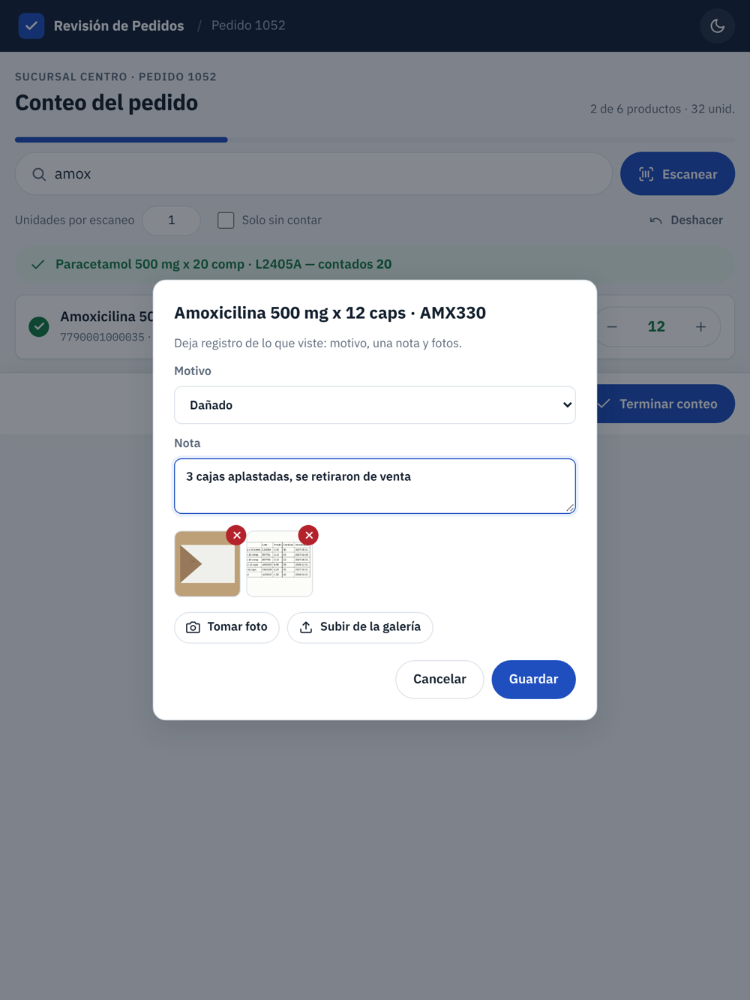
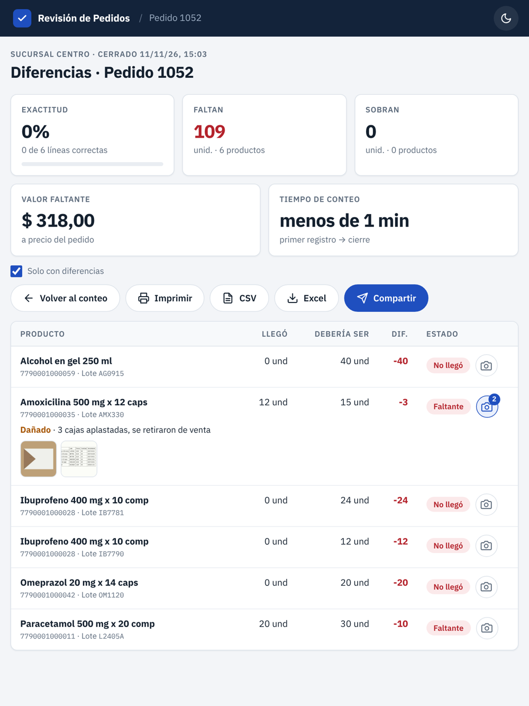
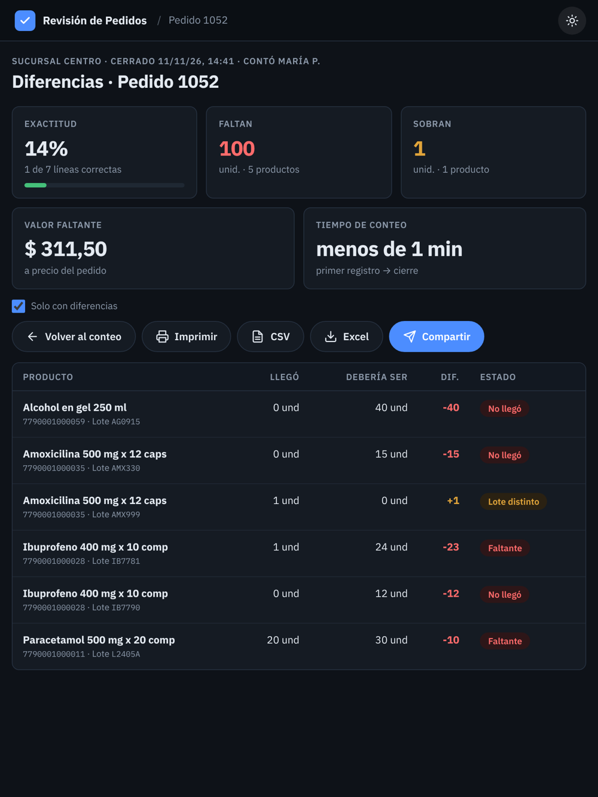
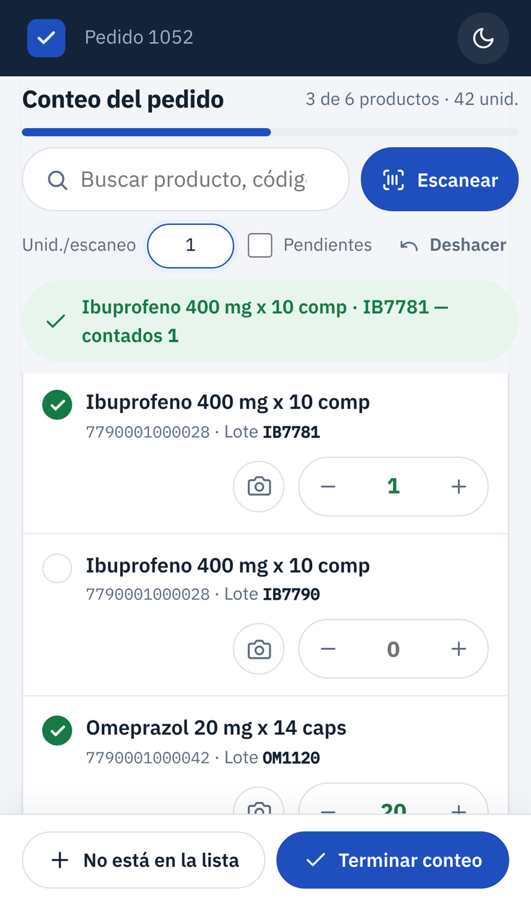
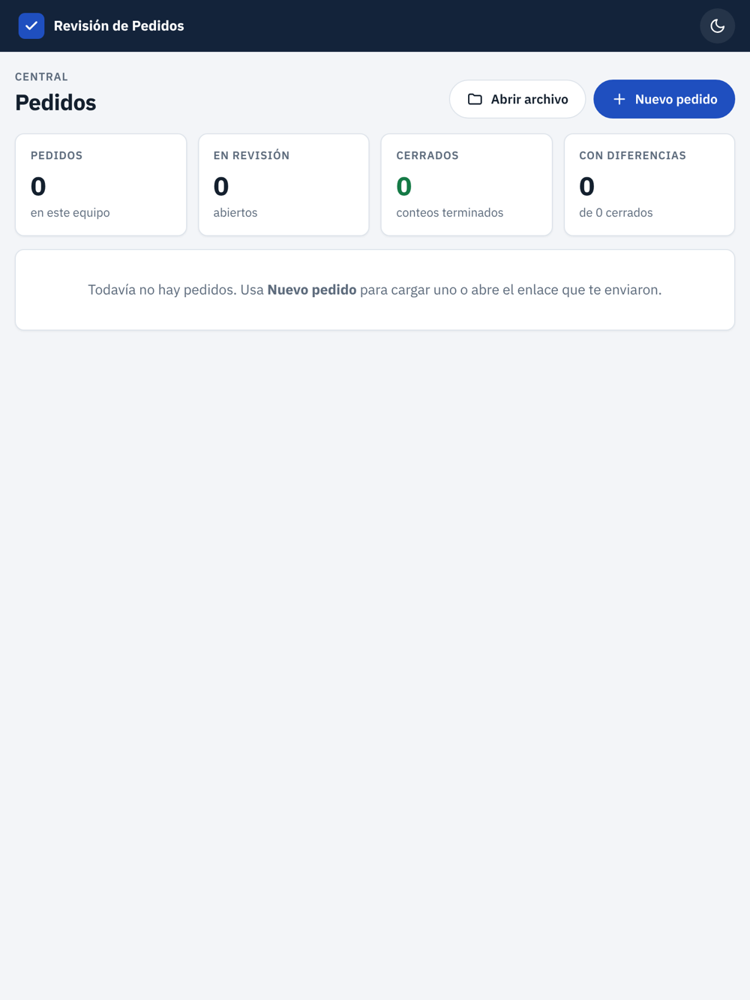
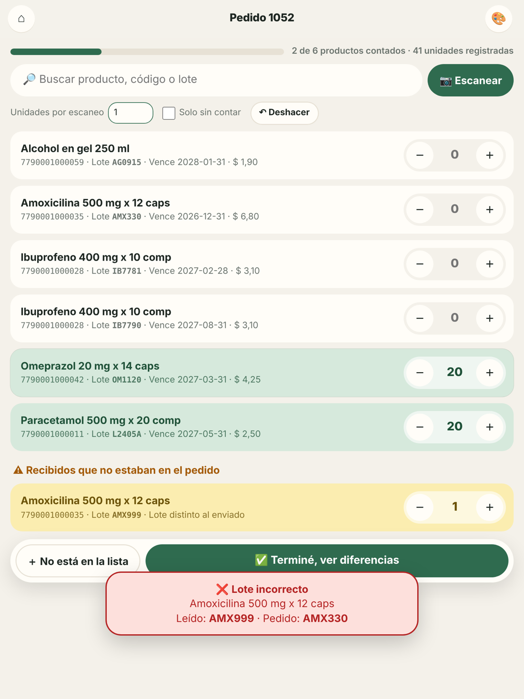
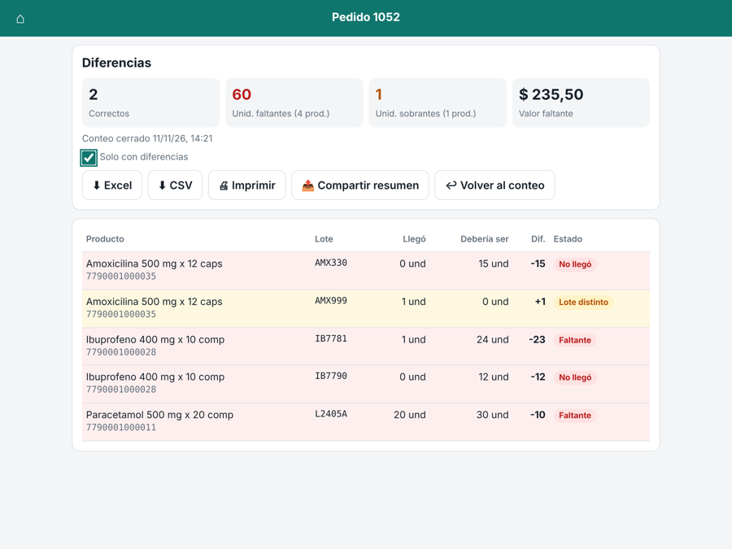

# Revisión de pedidos en sucursal

App web para revisar el pedido que llega a la sucursal sin buscar producto por producto en una hoja impresa.

## Cómo funciona

1. **Central – cargar el pedido.** Sube el pedido en **Excel, CSV, Word (.docx) o PDF**, pega las filas desde Excel o saca una **foto de la hoja**. Columnas: código de barras, producto, lote, precio, cantidad y, opcional, vencimiento. Hay ejemplos en `ejemplo-pedido.csv`, `ejemplo-pedido.docx` y `ejemplo-pedido.pdf`.
   - Word y PDF: se lee la tabla del documento. Si el Word no tiene tabla, se lee línea por línea y se marca para revisar.
   - Foto: la app endereza la imagen, borra las líneas de la tabla y lee el texto. Todo lo leído queda **en amarillo para revisar** y cada dato se puede corregir antes de guardar.
   - La sucursal abre lo recibido con **Abrir pedido recibido** (archivo .pedido) o con el enlace.
2. **Enviar a la sucursal.** Botón *Compartir enlace* (WhatsApp, correo) o *Descargar archivo*. El pedido viaja comprimido: la sucursal **no ve las cantidades enviadas**.
3. **Sucursal – contar.** Abre el enlace y cuenta lo que trae la cubeta:
   - Buscador por nombre, código o lote.
   - **📷 Escanear** con la cámara del celular: cada lectura suma 1 (o las unidades que indiques por escaneo, útil para cajas).
   - Si el código es **DataMatrix / GS1-128** (los que traen lote y vencimiento), la app **lee el lote y verifica** que sea el del pedido. Si no coincide, avisa con sonido y lo registra como “Lote distinto”.
   - Si el producto viene en varios lotes y el código no trae lote, pregunta cuál es.
   - Productos que llegaron pero no estaban en el pedido se registran como sobrantes.
   - También sirve un lector de código de barras USB/Bluetooth: se escanea en el buscador.
   - El avance se guarda en el celular; se puede cerrar y seguir después.
   - **Evidencia:** el botón de cámara de cada producto permite indicar un motivo (dañado, vencido, lote distinto…), escribir una nota y sacar o subir fotos.
4. **Terminé, ver diferencias.** Recién ahí se muestra lo contado vs. lo que debería ser:

   | Producto | Lote | Llegó | Debería ser | Dif. |
   |---|---|---|---|---|
   | Paracetamol 500 mg | L2405A | 20 und | 30 und | −10 |

   Se puede exportar a Excel/CSV, imprimir o compartir el resumen por WhatsApp. Si se reabre el conteo, queda registrado.

## Usuarios e inicio de sesión

- La primera vez la app pide crear el **administrador** (nombre, usuario y contraseña).
- El administrador crea usuarios desde el menú de usuario → **Usuarios**, con dos roles:
  - **Administrador:** carga pedidos, inventarios y el maestro, ve las cantidades, reabre conteos y administra usuarios.
  - **Sucursal:** solo cuenta (sin ver las cantidades) y ve las diferencias al cerrar. Su nombre queda como "Contado por".
- Las contraseñas se guardan cifradas (PBKDF2) en el equipo, nunca en texto.
- Para usar los mismos usuarios y el maestro en otra tablet: menú → **Exportar configuración** y, en la otra tablet, **Importar configuración**.
- Limitación: sin servidor, los usuarios viven en cada equipo. Sirve para identificar quién cuenta y limitar lo que ve cada uno en una tablet compartida, no como seguridad frente a alguien con conocimientos técnicos.

## Maestro de productos

Menú de usuario → **Maestro de productos** → subir el Excel (columnas *Material*, *Texto breve de material*, *Unidad medida base*, *Código EAN/UPC*). Con el maestro, al escanear el código de barras de una caja la app sabe qué producto es, también en pedidos.

## Inventarios

1. **Nuevo inventario** → subir el **reporte de existencias** (PDF o Excel). La app lee la sucursal, la fecha y cada producto con su código, nombre, categoría y cantidad del sistema, y le agrega el código de barras desde el maestro.
2. La sucursal cuenta **sin ver las cantidades del sistema**: escaneando, buscando por nombre o código de material, con filtro por categoría. Si escanea algo que no figura en el reporte, la app muestra el nombre desde el maestro y lo registra como sobrante.
3. Al cerrar: **Contado vs Sistema** por producto (faltante, sobrante, no encontrado, no figura en sistema), con exportación a Excel (material, código de barras, categoría).

Probado con el reporte real de existencias CL0007 Renca (1.219 productos, 22.969 unidades, 6 categorías): el 91 % de los productos se puede escanear con el maestro.

## Evidencia con fotos

 

El motivo, la nota y las fotos salen en el reporte de diferencias, en el Excel (columnas Motivo, Nota y Fotos) y al **Compartir** se adjuntan las fotos cuando el equipo lo permite (WhatsApp, correo). Al **Imprimir** el reporte las fotos también aparecen. Las fotos se guardan en el dispositivo y se achican para ocupar poco espacio.

## Carga desde una foto

## Diseño

Estilo **Ejecutivo**: barra azul marino, azul corporativo, tablas ordenadas, íconos de línea y botones redondos. El botón de la luna (arriba a la derecha) cambia a **modo oscuro**, útil en bodegas con poca luz.

 

## Instalar en la tablet (funciona sin internet)

Abrir la página en Chrome/Safari → menú → **Agregar a pantalla de inicio**. Queda como app con ícono propio y, después de abrirla una vez con internet, se puede contar sin conexión.

Al cerrar el conteo se registra **quién contó** y la hora de inicio y cierre (aparece en el resumen, en el Excel y en el mensaje de WhatsApp).

## Proceso completo (vista en tablet)

### 1. Central: cargar y enviar el pedido
**Paso 1.** Inicio: lista de pedidos. Botón **Cargar pedido nuevo**.

**Paso 2.** Se sube el Excel/CSV. La central ve producto, lote, precio y cantidad. **Guardar pedido**.

**Paso 3.** Pedido guardado. **Compartir enlace** (WhatsApp/correo) o **Descargar archivo** para la sucursal.

### 2. Sucursal: contar lo que llegó
**Paso 4.** La sucursal abre el enlace y toca **Comenzar conteo**.

**Paso 5.** Lista de productos **sin las cantidades enviadas**; todo empieza en 0.

**Paso 6.** Buscador: al escribir "para" aparece el Paracetamol. Se suma con + / − o escribiendo la cantidad.

**Paso 7.** **Escanear** con la cámara: cada lectura suma 1 (o las *unidades por escaneo*) y avisa qué producto contó.

**Paso 8.** Código DataMatrix/GS1 con lote: la app lee el lote y confirma que es el correcto.

**Paso 9.** Lote distinto al del pedido: alerta roja con sonido; queda registrado como diferencia.

**Paso 10.** Mismo producto en varios lotes y código sin lote: la app pregunta cuál es.

**Paso 11.** Avance: verde = contado, naranja = llegó y no estaba en el pedido.

**Paso 12.** **Terminé, ver diferencias**: avisa cuántos productos quedan en 0 y cierra el conteo.

### 3. Resultado: diferencias
**Paso 13.** Diferencias: **Llegó** vs **Debería ser** (ej. Paracetamol 20 und / 30 und → −10).

**Paso 14.** Desmarcando *Solo con diferencias* se ven también los correctos.

**Paso 15.** Tablet en horizontal. Exportar a Excel/CSV, imprimir o compartir por WhatsApp.

## Publicación

Es una página estática (HTML + JS, sin servidor). Para usarla desde el celular:

1. En GitHub: **Settings → Pages → Source: GitHub Actions**.
2. Al hacer merge a `main`, se publica sola en `https://<usuario>.github.io/revisionsucursal/`.

La cámara solo funciona en `https://` (GitHub Pages ya lo es) o en `localhost`.

Para probar en la computadora: `python3 -m http.server` y abrir `http://localhost:8000`.

## Limitaciones actuales

- Los datos se guardan en cada dispositivo (no hay base de datos central). La central recibe el resultado por Excel o WhatsApp.
- Los códigos EAN-13 normales no traen lote; para verificar lote automáticamente hace falta el DataMatrix/GS1 de la caja.
- Leer Word, PDF y fotos requiere internet la primera vez (se descarga el lector). Las fotos de hojas se leen bien si están derechas, enfocadas y con buena luz; siempre conviene revisar.
- Word antiguo (.doc) no se lee: hay que guardarlo como .docx.
- Las fotos de evidencia quedan en el equipo donde se tomaron; la central las recibe al compartir el reporte.
